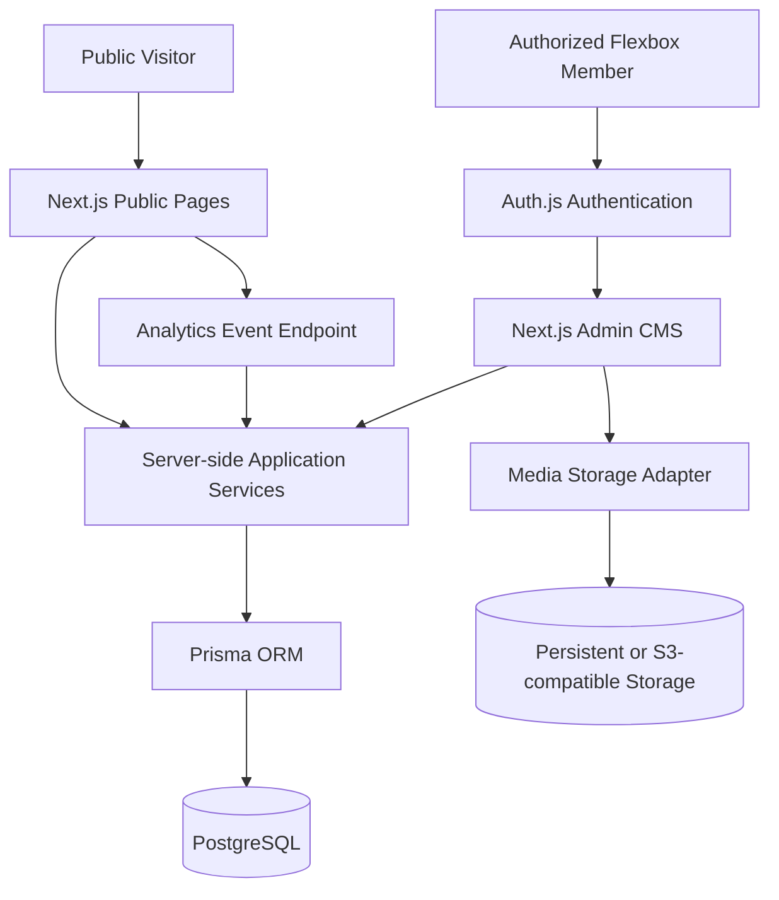
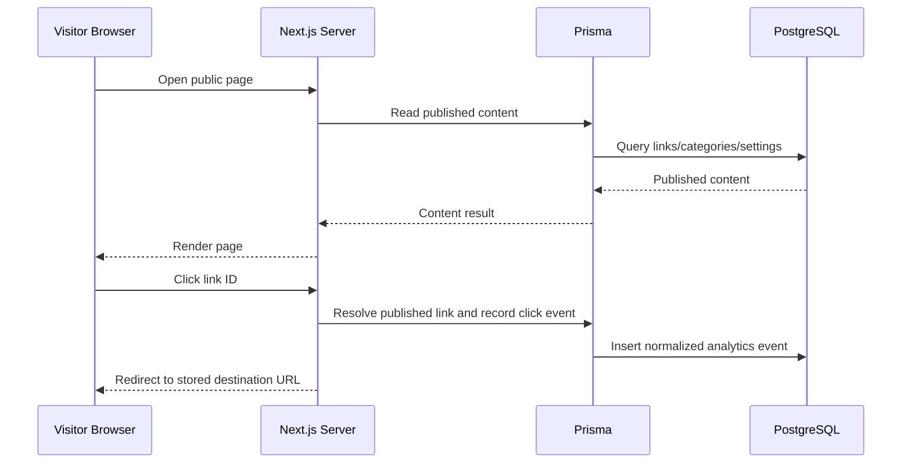

# System Architecture

**Product:** Flexbox Linktree / Flexbox Studio Digital Hub  
**Status:** Initial architecture baseline  
**Language:** English

## 1. Architecture Summary

Flexbox Linktree is a single Next.js application with two user-facing areas:

- Public microsite: editorial directory, branding, contact, and SEO metadata.
- Private CMS: authentication, content management, settings, media, and analytics.

The initial persistence layer is PostgreSQL accessed through Prisma ORM. The application is developed locally on Windows, tested against an isolated local PostgreSQL container, and deployed to a Flexbox-managed VPS through Coolify.

The architecture should remain a modular monolith for the first release. Do not split the product into microservices until measured scale, operational needs, or team ownership justify that complexity.

## 2. High-Level Context

## 3. Deployment Topology

### 3.1 Local Development

- Windows workstation with VS Code and PowerShell.
- Next.js runs directly on the host for fast hot reload.
- PostgreSQL runs in Docker Desktop/WSL2.
- Local database is exposed only on loopback, currently `127.0.0.1:5433` on the host mapped to container port `5432`.
- `.env.local` contains local-only variables and must never be committed.

### 3.2 Staging

Staging is recommended before production. It must use:
- A separate application deployment/environment.
- A separate PostgreSQL database or isolated PostgreSQL instance.
- Separate authentication secrets and provider credentials.
- Dummy or sanitized data only.
- No connection to the production database.

If budget prevents a separate staging VPS, staging may initially run as isolated services on the same VPS, with strict resource limits and separate credentials. Do not treat a separate database name on the production database as equivalent to full infrastructure isolation.

### 3.3 Production

Initial production can run on one VPS managed by Coolify:
- Next.js application container.
- PostgreSQL container/service with persistent storage.
- Coolify reverse proxy and HTTPS.
- Persistent media volume or external object storage.
- Backup process that sends database/media backups off the VPS.

Keep PostgreSQL private to the application network. Do not expose database port `5432` to the public internet. Use SSH keys, firewall rules, and least-privilege database credentials.

## 4. Application Structure

Use Next.js App Router and organize code by route and feature/domain:

- `app/(public)`: public microsite routes and public layouts.
- `app/admin`: protected CMS routes.
- `app/api`: narrowly scoped route handlers for authentication callbacks, analytics collection/redirect, uploads, and integrations where needed.
- `features`: business logic for links, categories, settings, media, analytics, and admin access.
- `lib`: infrastructure adapters such as Prisma, Auth.js, validation, logging, and security helpers.
- `components`: reusable presentation components separated into public/admin/shared areas.

Use Server Components by default. Add Client Components only for interactive controls such as forms, tables with client-side interaction, charts, menus, and date filters.

## 5. Main Routes

| Route | Purpose | Access |
|---|---|---|
| `/` | Public digital hub | Public |
| `/admin/login` | Admin sign-in | Public route, authentication only |
| `/admin` | Admin dashboard | Super Admin |
| `/admin/links` | Link management | Super Admin |
| `/admin/links/new` | Create link | Super Admin |
| `/admin/links/[id]` | Edit link | Super Admin |
| `/admin/categories` | Category management | Super Admin |
| `/admin/media` | Media library | Super Admin |
| `/admin/settings` | Website settings | Super Admin |
| `/admin/analytics` | Analytics overview | Super Admin |
| `/admin/analytics/links` | Link performance | Super Admin |
| `/admin/analytics/audience` | Device/browser/OS breakdown | Super Admin |
| `/admin/admins` | Admin account management | Super Admin |
| `/admin/audit-logs` | Administrative audit history | Super Admin |

Route names may be adjusted during implementation, but public/admin access boundaries must remain clear.

## 6. Domain Modules

### 6.1 Content

Owns link, category, settings, and publication rules. Public queries must return only active, published records and active categories.

### 6.2 Authentication and Authorization

Auth.js handles authentication/session integration. Application authorization checks the active allowlisted member record and the `SUPER_ADMIN` role. Every protected server action, route handler, and server-side data access must perform authorization independently.

Do not rely solely on middleware or client-side route hiding. Middleware/proxy can provide an early redirect, but it is not the only authorization boundary.

**Provider/session decision (recorded):**

The approved strategy is the **Auth.js Credentials provider with JWT sessions**, using the stable NextAuth v4 line that declares support for Next.js 16.

Rationale:

- The administrator population is a small, fixed, explicitly allowlisted Flexbox team. There is no public registration and no self-service onboarding.
- No external OAuth identity provider or client credentials are available, and requiring one would add an undecided external prerequisite for every administrator.
- Credentials keeps account provisioning internal: a `SUPER_ADMIN` creates or seeds the account, and the application owns the full access lifecycle.
- Auth.js Credentials requires the JWT session strategy. A Prisma adapter does not persist Credentials users and does not convert Credentials sessions into database sessions. Therefore the application must implement account lookup, password verification, rate limiting, and provisioning explicitly.

Consequences that must be implemented in the authentication phase:

- An application-owned admin identity record (allowlist membership, `SUPER_ADMIN` role, active/inactive state) is the authorization source of truth. The Auth.js user object is only an authentication artifact.
- Passwords are hashed with Argon2id and never logged or returned.
- `AUTH_SECRET` signs JWT sessions and must be unique per environment.
- Session revocation relies on short JWT lifetimes plus an active-status check on every protected request, not on deleting a database session row.
- MFA is a later enhancement. Until then, login rate limiting and strong password policy are mandatory.

Rejected alternative: OAuth provider with the Prisma adapter and database sessions. It is a reasonable design for larger organizations, but it adds an external identity-provider dependency that is not available for this release. The architecture stays compatible with that option because authorization is enforced by the application allowlist, not by the Auth.js adapter.

### 6.3 Media

Use a storage interface so local storage and production object storage can be swapped without changing CMS business logic. Store metadata and storage keys in PostgreSQL; store binary files in persistent/object storage, not as database blobs by default.

**Storage decision (recorded):**

- **Local development:** a `LocalStorageAdapter` writes to the ignored `storage/uploads/` directory. The directory is persistent across Next.js restarts but is local-only and never committed.
- **Production:** use an S3-compatible object-storage provider with a separate backup and lifecycle policy. The provider, bucket, region, endpoint, and credentials remain deployment decisions and are not required for Phase 0 or Phase 1.
- **Boundary:** CMS code depends on the storage interface, not a provider SDK. Only a storage adapter reads provider-specific configuration.

This decision avoids external credentials during foundation work while preventing production media from being placed in an ephemeral application container.

### 6.4 Analytics

Analytics is an application module, not a separate microservice in the first release. Store normalized events in PostgreSQL and produce aggregate queries/materialized daily summaries as volume justifies.

## 7. Analytics Data Flow

The click endpoint must resolve the target by a valid published link ID. It must not accept an arbitrary destination URL from the browser, which would create an open-redirect vulnerability. Analytics persistence should be best-effort: if event recording fails, navigation should still succeed.

## 8. Analytics Data Design

Initial entities may include:
- `AnalyticsEvent`: immutable event occurrence, event type, UTC timestamp, optional link ID, session identifier hash/reference, and normalized dimensions.
- `AnalyticsDailyAggregate`: date, metric/dimension keys, counts, and aggregation version.
- `AnalyticsSession`: optional coarse session record if required for session and returning-visitor estimates.

Do not store raw IP addresses or detailed device fingerprints. Store normalized device/browser/OS families. Sanitize referrer data and avoid query strings that may contain identifiers. Exclude admin traffic and known bots where practical.

Use indexes for common filters: `occurredAt`, `eventType`, `linkId`, and selected dimension/date combinations. Do not prematurely partition tables or introduce a data warehouse.

Default reporting timezone: `Asia/Jakarta`. Store all event timestamps in UTC; convert only for report boundaries and display.

Initial raw-event retention target: 90 days, subject to privacy review. Aggregated daily metrics may be kept longer.

## 9. Data Model Domains

The schema should be designed around these domains:

| Domain | Suggested entities |
|---|---|
| Identity | Auth.js User/Account/Session tables if adapter strategy is selected; AdminMembership or admin profile; AdminInvitation |
| Content | Link, Category, SiteSetting |
| Media | MediaAsset |
| Analytics | AnalyticsEvent, AnalyticsDailyAggregate, optional AnalyticsSession |
| Operations | AuditLog |

Use UUID identifiers, unique slugs, foreign keys, explicit status fields, timestamps, and indexes. Define deletion behavior deliberately. Avoid cascading deletion of historical analytics when a link is deleted; preserve a snapshot or nullable reference as appropriate.

## 10. Security Architecture

- No public registration.
- Only allowlisted, active Flexbox members with `SUPER_ADMIN` role can access the CMS.
- Verify authorization on every server-side mutation and protected data query.
- Use secure session cookies and HTTPS in production.
- Keep OAuth credentials, `AUTH_SECRET`, and database credentials out of Git.
- Hash passwords with a modern password-hashing algorithm if Credentials login is selected.
- Rate-limit login, invitation, password-reset, and analytics endpoints.
- Validate inputs using Zod (or an approved equivalent) on the server.
- Restrict URL protocols and redirect destinations.
- Validate uploaded files by size and actual MIME/content type.
- Keep database networking private.
- Use least-privilege database users and separate credentials per environment.
- Record relevant admin actions without logging secrets.

## 11. Environment and Configuration

Use distinct values for:
- Local development.
- Automated tests.
- Staging.
- Production.

Never share a database URL, Auth.js secret, OAuth secret, or storage credential across environments. `.env.local` is for local Next.js development. Docker Compose automatically reads `.env` by default, not `.env.local`; keep local Compose credentials explicit or place Compose-only variables in a separate ignored `.env` file. Ensure the host port and database URL match.

## 12. Database Migration and Release

- Create schema changes using reviewed Prisma migrations in development.
- Commit migration files to Git.
- Run `prisma migrate deploy` during controlled staging/production release.
- Never run `prisma migrate dev` against production.
- Take a verified backup before risky production schema changes.
- Use a tested rollback/forward-fix plan; database rollback is not assumed to be automatic.

## 13. Observability and Backup

- Application health endpoint or equivalent health check.
- Container health checks.
- Structured logs with secrets and personal data redacted.
- Resource monitoring for CPU, RAM, disk, and database storage.
- Automated database backups stored outside the VPS.
- Media backup or object-storage durability strategy.
- Periodic restore tests.

Persistent Docker volumes protect against container replacement, not VPS loss. A backup stored only on the production VPS is not an independent backup.

## 14. Design Document Relationship

`.docs/Desain.md` remains the primary visual design guide for the public microsite. This architecture and the approved PRD extend the product scope to include the private CMS, authentication, PostgreSQL, and analytics. Where the earlier design document says that admin, login, database, or CMS are not product goals, the newer approved product requirements supersede that scope statement. Its visual rules, public-page hierarchy, typography, color, responsiveness, and accessibility guidance remain applicable unless explicitly revised.

`Desain.md` is preserved in its original Indonesian language and is not rewritten. It still references the earlier Vite/React prototype (`src/App.tsx`, `src/index.css`, `src/main.tsx`, `index.html`) and a small starter `LinkItem` shape. Those implementation references are historical. The normative parts — brand palette, typography rules, spacing scale, editorial directory behavior, link-card anatomy, accessibility targets, and prohibited visual patterns — apply to the Next.js `src/app/(public)` implementation.

## 15. Document Map

| Document | Authority |
|---|---|
| `.docs/PRD.md` | Functional scope and acceptance criteria (authoritative) |
| `.docs/Architecture.md` | System boundaries, data flow, and recorded technical decisions |
| `.docs/Tech-Stack.md` | Selected technologies, versions, and version policy |
| `.docs/Structure_File.md` | Repository layout and import conventions |
| `.docs/Roadmap.md` | Phases and measurable exit criteria |
| `.docs/Desain.md` | Public visual system (original form preserved) |
| `.docs/LOCAL_DEVELOPMENT.md` | Repeatable local Windows setup |
| `AGENTS.md` | Operative implementation rules for contributors and assistants |
